<div align="center">
  
  
</div>

<div align="center">

[](#) [](#) [](#) [](#) [](#) [](#)

</div>


## ◆ quién soy

```ts
const mau = {
  rol: "Full Stack Developer",
  foco: ["apps web", "apps móviles", "APIs REST", "dashboards"],
  frontend: ["React", "Next.js", "Angular 20", "TypeScript", "Tailwind", "shadcn/ui"],
  backend: ["Node.js", "Express", "NestJS", "Prisma", "Sequelize"],
  datos: ["PostgreSQL", "MySQL", "MongoDB"],
  movil: ["React Native", "Expo"],
  devops: ["Docker", "GitHub Actions", "PWA"],
  practicas: ["tipado estricto", "validación con Zod", "JWT + Helmet", "CI/CD"],
} satisfies Profile;
```

Construyo productos de punta a punta: modelo de datos, API, interfaz y despliegue. Me interesa el código que aguanta producción: **tipado, validado, testeado y automatizado**.


## ◆ stack

<div align="center">
  
</div>


## ◆ proyectos más completos

<div align="center">
<table>
  <tr>
    <td align="center" width="50%">
      <a href="https://github.com/Mau6987/jenn-front">
        
      </a>
    </td>
    <td align="center" width="50%">
      <a href="https://github.com/Mau6987/SISPINOS">
        
      </a>
    </td>
  </tr>
  <tr>
    <td align="center" width="50%">
      <a href="https://github.com/Mau6987/frontendSistemaIntegrado">
        
      </a>
    </td>
    <td align="center" width="50%">
      <a href="https://github.com/Mau6987/tienda-militar-front">
        
      </a>
    </td>
  </tr>
  <tr>
    <td align="center" width="50%">
      <a href="https://github.com/Mau6987/movil-back-pos">
        
      </a>
    </td>
    <td align="center" width="50%">
      <a href="https://github.com/Mau6987/modulo2CRUD">
        
      </a>
    </td>
  </tr>
</table>
</div>

| Proyecto | Qué resuelve | Stack |
|---|---|---|
| **[jenn-front](https://github.com/Mau6987/jenn-front) + [jenn-back-reac](https://github.com/Mau6987/jenn-back-reac)** | Plataforma de gestión deportiva con roles, dashboards, gráficas, reportes PDF y notificaciones en tiempo real | Next.js, MUI, Chakra, Pusher, Express, Sequelize, PostgreSQL, JWT, Cloudinary |
| **[SISPINOS](https://github.com/Mau6987/SISPINOS)** | PWA de gestión que funciona offline, con gráficas y exportación de reportes | Next.js, Tailwind, Radix UI, Workbox, Chart.js |
| **[frontendSistemaIntegrado](https://github.com/Mau6987/frontendSistemaIntegrado)** | SPA de sistema integrado con reportes y soporte instalable | React, Vite, MUI, Bootstrap, PWA, jsPDF |
| **[tienda-militar-front](https://github.com/Mau6987/tienda-militar-front) + [back](https://github.com/Mau6987/tienda-militar-back)** | Sistema de inventario con autenticación y panel de métricas | Next.js, Tailwind, Express, Prisma, JWT |
| **[movil-back-pos](https://github.com/Mau6987/movil-back-pos)** | API de punto de venta con validación estricta y hardening | TypeScript, Express, Prisma, Zod, Helmet |
| **[modulo2CRUD](https://github.com/Mau6987/modulo2CRUD)** | CRUD empresarial con pruebas unitarias | Angular 20, TypeScript, RxJS, Karma |
| **[portafolio-arcani-junior](https://github.com/Mau6987/portafolio-arcani-junior)** | Portafolio personal desplegado en Vercel | Next.js, Tailwind, shadcn/ui, Framer Motion |

> Selección por completitud: commits activos, README, paginación/roles, pruebas y despliegue.


## ◆ métricas

<div align="center">
  
  
</div>

<div align="center">
  
</div>

<div align="center">
  
</div>

<!-- Serpiente: se activa cuando el workflow 'Snake' corra por primera vez
<div align="center">
  <picture>
    <source media="(prefers-color-scheme: dark)" srcset="https://raw.githubusercontent.com/Mau6987/Mau6987/output/github-contribution-grid-snake-dark.svg"/>
    <source media="(prefers-color-scheme: light)" srcset="https://raw.githubusercontent.com/Mau6987/Mau6987/output/github-contribution-grid-snake.svg"/>
    
  </picture>
</div>
-->


## ◆ proyectos privados

Parte de mi trabajo está en repositorios privados de clientes y equipos: dashboards operativos, sistemas de inventario/ERP, apps móviles de campo con geolocalización y automatizaciones con **n8n**. Stack habitual: **NestJS, Express, Prisma, PostgreSQL, React/Next.js y React Native**.


## ◆ contacto

<div align="center">

[](https://github.com/Mau6987)
<!-- LinkedIn: agrega tu URL y descomenta
[](https://www.linkedin.com/in/TU-USUARIO)
-->
<!-- Email: agrega tu correo y descomenta
[](mailto:TU@CORREO.com)
-->

<br/>


*Abierto a colaborar en productos web y móviles de punta a punta.*

</div>
