<div align="center">
  
  
</div>

<div align="center">

[](#) [](#) [](#) [](#) [](#) [](#) [](#) [](#)

</div>


## ◆ quién soy

```ts
const mau = {
  rol: "Full Stack Developer",
  foco: ["apps web", "apps móviles", "APIs REST", "dashboards"],
  frontend: ["React", "Next.js", "Angular 20", "TypeScript", "Tailwind", "shadcn/ui"],
  backend: ["Node.js", "Express", "NestJS", "FastAPI", "Prisma", "SQLAlchemy"],
  datos: ["PostgreSQL", "MySQL", "MongoDB", "Redis"],
  movil: ["React Native", "Expo", "Flutter"],
  devops: ["Docker", "GitHub Actions", "Dokploy", "PWA"],
  practicas: ["tipado estricto", "validación con Zod", "JWT + Helmet", "RLS en PostgreSQL", "CI/CD"],
} satisfies Profile;
```

Construyo productos de punta a punta: modelo de datos, API, interfaz y despliegue. Me interesa el código que aguanta producción: **tipado, validado, testeado y automatizado**.


## ◆ stack

<div align="center">
  
</div>


## ◆ proyectos

El más completo es **MoneyMap**: un SaaS de finanzas personales con app móvil, web y API, cada uno en su propio repositorio.

<div align="center">
<table>
  <tr>
    <td align="center" width="50%">
      <a href="https://github.com/Mau6987/moneymap-app">
        
      </a>
    </td>
    <td align="center" width="50%">
      <a href="https://github.com/Mau6987/moneymap-web">
        
      </a>
    </td>
  </tr>
  <tr>
    <td align="center" width="50%">
      <a href="https://github.com/Mau6987/moneymap-back">
        
      </a>
    </td>
    <td align="center" width="50%">
      <a href="https://github.com/Mau6987/rutacheck-case-study">
        
      </a>
    </td>
  </tr>
  <tr>
    <td align="center" width="50%">
      <a href="https://github.com/Mau6987/jenn-front">
        
      </a>
    </td>
    <td align="center" width="50%">
      <a href="https://github.com/Mau6987/SISPINOS">
        
      </a>
    </td>
  </tr>
  <tr>
    <td align="center" width="50%">
      <a href="https://github.com/Mau6987/tienda-militar-front">
        
      </a>
    </td>
    <td align="center" width="50%">
      <a href="https://github.com/Mau6987/movil-back-pos">
        
      </a>
    </td>
  </tr>
</table>
</div>

| Proyecto | Qué resuelve | Stack |
|---|---|---|
| **[moneymap-app](https://github.com/Mau6987/moneymap-app)** | App iOS/Android/web de finanzas personales: gastos e ingresos en segundos, Safe to Spend, metas y presupuestos | Flutter, Riverpod, go_router, Firebase, Maestro |
| **[moneymap-web](https://github.com/Mau6987/moneymap-web)** | Panel web del mismo producto, con cliente generado desde el contrato OpenAPI | Next.js, TypeScript, Tailwind, openapi-fetch, Vitest, Docker |
| **[moneymap-back](https://github.com/Mau6987/moneymap-back)** | API con CQRS modular, RLS en PostgreSQL, jobs en segundo plano y registro por voz con IA propia | FastAPI, PostgreSQL, SQLAlchemy, Alembic, Celery, Redis |
| **[rutacheck-case-study](https://github.com/Mau6987/rutacheck-case-study)** | Caso de estudio de RutaCheck: panel de supervisión de visitadores con GPS en vivo y alertas antifraude (código privado) | React, TanStack Router/Query, Tailwind, Zod, Leaflet, NestJS, PostgreSQL |
| **[jenn-front](https://github.com/Mau6987/jenn-front) + [jenn-back-reac](https://github.com/Mau6987/jenn-back-reac)** | Plataforma de gestión deportiva con roles, dashboards, gráficas, reportes PDF y notificaciones en tiempo real | Next.js, MUI, Chakra, Pusher, Express, Sequelize, PostgreSQL, JWT, Cloudinary |
| **[SISPINOS](https://github.com/Mau6987/SISPINOS)** | PWA de gestión que funciona offline, con gráficas y exportación de reportes | Next.js, Tailwind, Radix UI, Workbox, Chart.js |
| **[frontendSistemaIntegrado](https://github.com/Mau6987/frontendSistemaIntegrado)** | SPA de sistema integrado con reportes y soporte instalable | React, Vite, MUI, Bootstrap, PWA, jsPDF |
| **[tienda-militar-front](https://github.com/Mau6987/tienda-militar-front) + [back](https://github.com/Mau6987/tienda-militar-back)** | Sistema de inventario con autenticación y panel de métricas | Next.js, Tailwind, Express, Prisma, JWT |
| **[movil-back-pos](https://github.com/Mau6987/movil-back-pos)** | API de punto de venta con validación estricta y hardening | TypeScript, Express, Prisma, Zod, Helmet |


## ◆ enfoque

- **Producto completo** — modelo de datos, API, interfaz y despliegue en un solo flujo.
- **Tipado y validación** — TypeScript estricto, Zod y contratos claros entre capas.
- **Seguridad** — JWT, Helmet, control de roles y secretos fuera del repositorio.
- **Automatización** — Docker, GitHub Actions y entornos reproducibles.


## ◆ proyectos privados

Buena parte de mi trabajo vive en repositorios privados:

- **RutaCheck** — panel de supervisión de visitadores farmacéuticos: KPIs, GPS en vivo, historial de rutas, turnos y alertas antifraude. **React, TanStack Router/Query, Tailwind, Leaflet, NestJS, PostgreSQL.** → [caso de estudio](https://github.com/Mau6987/rutacheck-case-study)
- **Automatización de pedidos** para una cadena de farmacias: API **NestJS** que expone PostgREST sobre **PostgreSQL** y dispara webhooks a **n8n**, con JWT y Docker. → [versión de portafolio](https://github.com/Mau6987/zurich-reqs-dashboard-backend)
- Sistemas de inventario/ERP, apps de campo con geolocalización y dashboards operativos con **React Native, Prisma y GitHub Actions**.


## ◆ contacto

<div align="center">

[](https://github.com/Mau6987)
<!-- LinkedIn: agrega tu URL y descomenta
[](https://www.linkedin.com/in/TU-USUARIO)
-->
<!-- Email: agrega tu correo y descomenta
[](mailto:TU@CORREO.com)
-->

<br/>

*Abierto a colaborar en productos web y móviles de punta a punta.*

</div>
